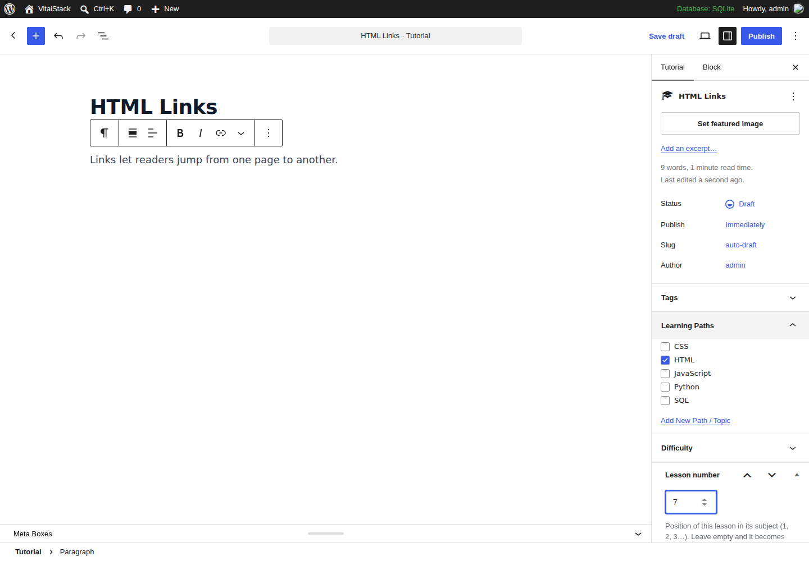

# Adding content to VitalStack

## Why "HTML" isn't in the top bar yet

A subject (HTML, CSS, JavaScript, SQL, Python) appears in the dark top bar
and on the homepage **only after it has at least one published lesson**.
An empty subject would lead to an empty page, so the theme hides it.
Publish your first HTML lesson and **HTML** appears automatically.

## The three kinds of content

| Kind | Where in WordPress | Use it for | Example |
|---|---|---|---|
| **Lesson** | Tutorials → Add New Tutorial | Step-by-step lessons inside a subject, read in order | "HTML Attributes" |
| **Guide** | Posts → Add New Post | Stand-alone articles on AI, tools, careers | "What are AI agents?" |
| **Page** | Pages | Fixed site pages (already created by VitalStack Setup) | About Us, Contact |

---

## What's already included: 100 lessons + 13 guides

The theme ships with a complete starter library, imported in one click from
**Appearance → VitalStack Setup → Import starter content** (steps in
[FRESH-SITE-SETUP.md](FRESH-SITE-SETUP.md) §3):

| Subject | Lessons | Ends with a project |
|---|---|---|
| HTML | 20 | Build a Personal Profile Page |
| CSS | 20 | Style Your Profile Page |
| JavaScript | 25 | To-Do List App |
| SQL | 15 | Library Database |
| Python | 20 | Simple Expense Tracker |

| Guide category | Guides |
|---|---|
| Artificial Intelligence | What Is AI?, How Large Language Models Work, What Are AI Agents? |
| AI Tools | Writing Better Prompts, AI Coding Assistants, Learn Programming Faster with AI |
| AI Career | AI Engineer Roadmap, Developer Skills in the Age of AI, Portfolio Guide |
| Programming | How to Start Learning to Code, Git and GitHub, Frontend vs Backend, How the Web Works |

Every lesson has an introduction, explained examples, common mistakes, an
exercise and a summary (600–1,500 words). HTML, CSS and JavaScript examples
have a working **Try it Yourself** button. All SQL results were checked
against a real database and all Python examples were run.

The source of every piece is a Markdown file in [`content/`](../content/), so
you can also edit them in Git and rebuild (see `content/README.md`). An
alternative import file for **Tools → Import → WordPress** is in
`content/import/vitalstack-all-content.xml`.

### Make them yours before publishing

This is the step that decides AdSense approval and long-term traffic. Google
rejected the old site for "low value content"; publishing a large library of
text that nobody has checked is the same risk. For each piece:

1. **Read it** and fix anything you'd explain differently.
2. **Run the examples** (Try it Yourself, an SQL tool, or Python).
3. **Add one thing only you can add:** a tip from your own learning, a
   screenshot of your editor, a mistake you made, a better example, a link to
   a related lesson.
4. **Publish**, ideally a few per day or week ("a few per day" import mode does
   the scheduling for you; you can still edit scheduled items before they go live).

Start with the HTML path and the first guides: they go out first.

---

## Writing a lesson yourself (step by step)



1. **Tutorials → Add New Tutorial**.
2. **Title**: short and specific, subject first: `HTML Links`, `CSS Colors`,
   `JavaScript Arrays`. No year, no "(Complete Guide)".
3. **Write the lesson** (structure below). Use:
   - **Heading** block (type `/heading`): H2 for each section, H3 for sub-points.
     H2/H3 headings automatically build "On this page".
   - **Code** block (type `/code`) for every example. Paste the code as plain
     text. HTML and JavaScript examples get a **Try it Yourself** button automatically.
   - Inline code: select a word → in the block toolbar click **⌄ (More)** → **Inline code**, e.g. `<p>`.
   - **List** block for steps and bullet points.
   - **Image** block for screenshots; always fill in **Alt text**.
4. **Right sidebar → Tutorial tab**:
   - **Learning Paths** → tick the subject (e.g. **HTML**).
   - **Difficulty** → Beginner / Intermediate / Advanced.
   - **Lesson number** → its position (1, 2, 3…). Leave it **empty** and the
     lesson becomes the next number in its subject when you publish.
   - **Excerpt** ("Add an excerpt") → one sentence about the lesson. It's shown
     on cards, in search results and in subscriber emails.
   - **Featured image** is optional (the theme shows a subject icon without one).
5. **Publish**. Subscribers get an email about the new lesson a couple of
   minutes later. To skip that (e.g. for a small lesson), tick *Don't email
   subscribers* in the **Email subscribers** box first.

The lesson now shows in the left sidebar, the Previous / Next buttons link
it to its neighbours, and the subject appears in the top bar.

### Lesson template

Copy this structure for every lesson:

1. **Intro** (2–3 sentences): what the reader will learn and why it matters.
2. **The main idea**, explained in plain words, then a **small example**.
3. **More sections**, each: explanation → example → what the example shows.
4. **Common mistakes**: 2–4 bullet points.
5. **Exercise**: 3–5 small tasks the reader does with Try it Yourself.
6. **Summary**: 3–5 bullet points.
7. One sentence pointing to the next lesson.

Aim for 600–1,200 words. Short paragraphs (2–4 sentences). One idea per section.

### Quality checklist before you click Publish

- [ ] Every code example runs (test it with Try it Yourself).
- [ ] Explained in your own words; no copied text from other sites.
- [ ] Headings tell the story on their own (read just the H2s).
- [ ] Links to 1–2 related VitalStack lessons and, where useful, official docs (MDN, w3.org, python.org).
- [ ] Excerpt filled in; Learning Path ticked; lesson number right.

---

## Writing a guide (blog post)

**Posts → Add New Post**: same editor. In the sidebar choose **one category**:

| Category | Write about |
|---|---|
| Artificial Intelligence | How AI works: LLMs, agents, machine learning, explained simply |
| AI Tools | Practical, tested how-tos: prompts, workflows, tool comparisons |
| AI Career | Skills, roadmaps, interview prep, first-job advice |
| Programming | Comparisons and projects beyond the lessons ("React vs Vue", "Build a portfolio site") |

Guide template: question in the title → 2-line answer up front → detailed
sections → real examples or screenshots → FAQ (3–5 questions) → summary.
Aim for 1,000–2,000 words.

---

## What to write next

The first 100 lessons are done. Good next subjects, each as a new learning
path (**Tutorials → Learning Paths → Add**): Git (10), React (20), Node.js and
Express (15), pandas (15), Data Structures and Algorithms (20). Good next
guides answer questions readers type into Google: "X vs Y", "how to do X",
"what is X", with honest, tested answers.

---

## Rhythm that works

- 2–3 pieces a week, every week. Consistency beats bursts.
- After every 5 lessons: re-read the subject from lesson 1 as a beginner and fix gaps.
- Every month: update your 5 most-visited pages (Search Console shows which).
- Apply for AdSense when you have **30+ published pieces** and every box in
  [ADSENSE-APPROVAL.md](ADSENSE-APPROVAL.md) is ticked.

---

## Writing lessons as files

Lessons and guides can also be written as Markdown in `content/lessons/<subject>/`
and `content/guides/<category>/` (front matter documented in `content/README.md`),
then bundled into the theme with:

```
python3 tools/build_starter_content.py
```

Upload the re-zipped theme and click **Import starter content** again: only
new items are added.
